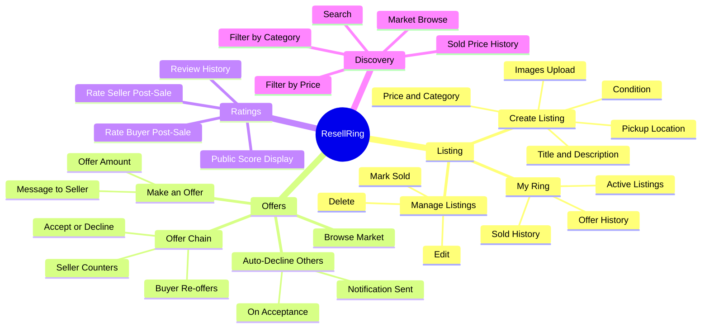
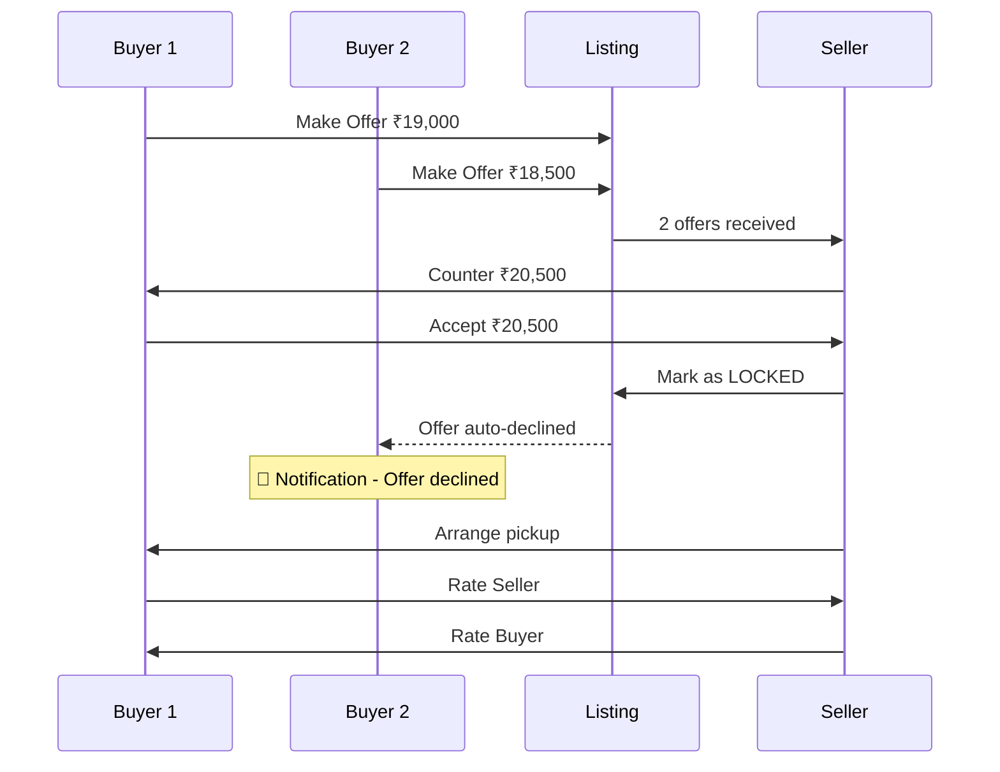
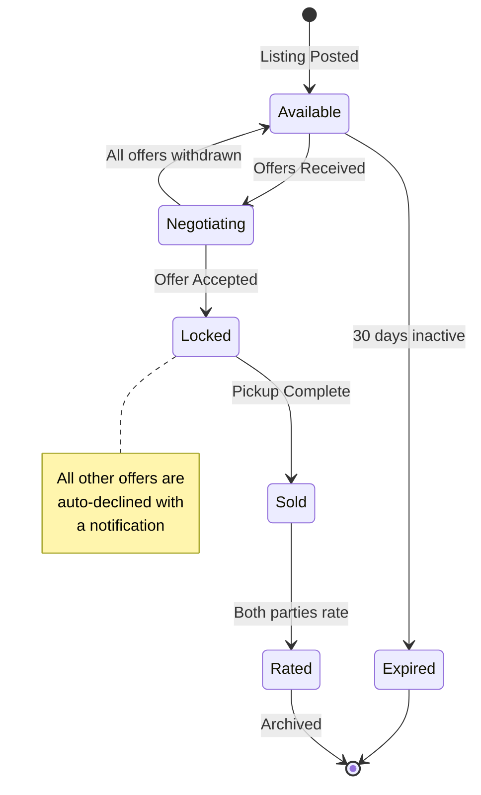
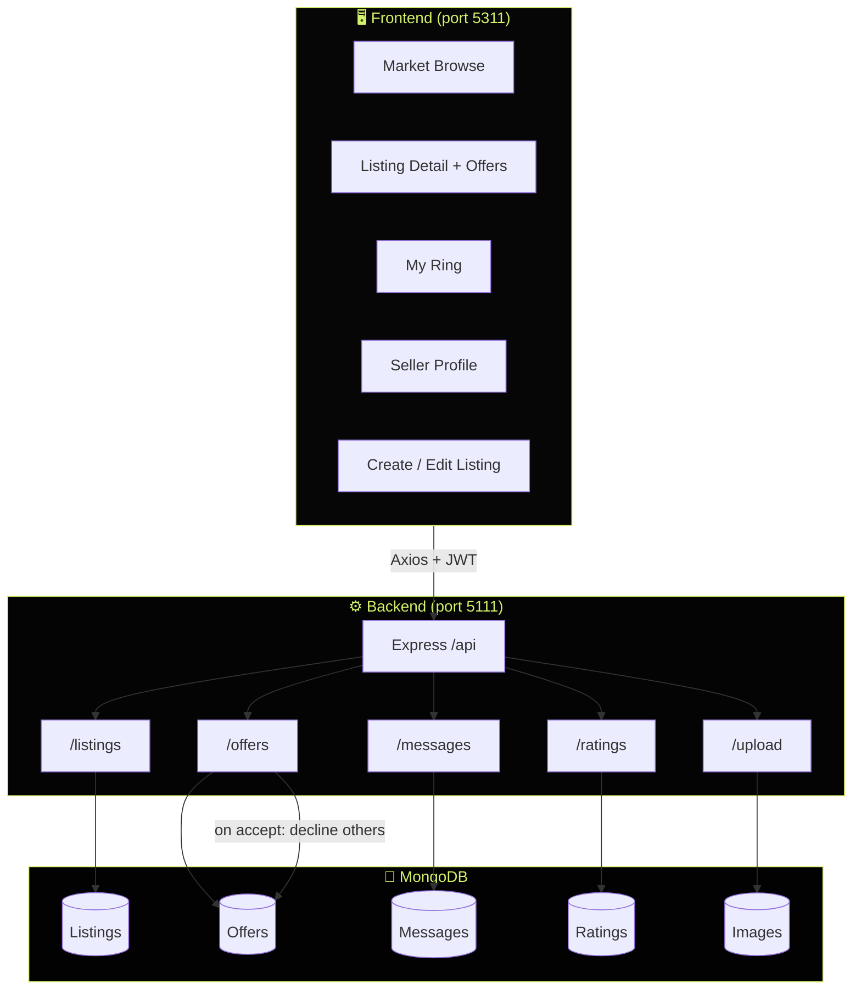
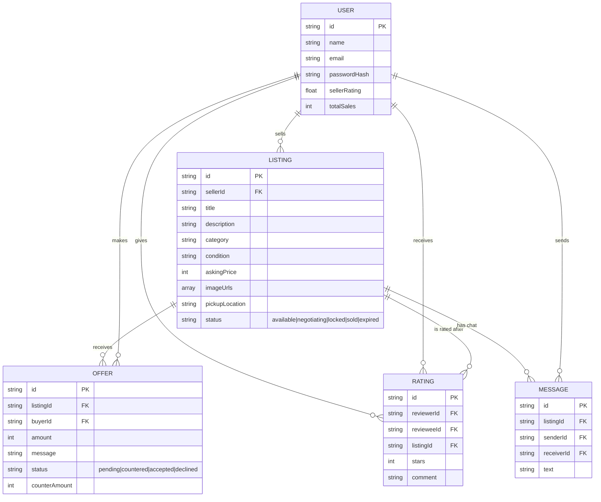

<div align="center">

```
██████╗ ███████╗███████╗███████╗██╗     ██╗     ██████╗ ██╗███╗   ██╗ ██████╗
██╔══██╗██╔════╝██╔════╝██╔════╝██║     ██║     ██╔══██╗██║████╗  ██║██╔════╝
██████╔╝█████╗  ███████╗█████╗  ██║     ██║     ██████╔╝██║██╔██╗ ██║██║  ███╗
██╔══██╗██╔══╝  ╚════██║██╔══╝  ██║     ██║     ██╔══██╗██║██║╚██╗██║██║   ██║
██║  ██║███████╗███████║███████╗███████╗███████╗██║  ██║██║██║ ╚████║╚██████╔╝
╚═╝  ╚═╝╚══════╝╚══════╝╚══════╝╚══════╝╚══════╝╚═╝  ╚═╝╚═╝╚═╝  ╚═══╝ ╚═════╝
```

### 💰 *The campus resale marketplace — no ghosting, no chaos, just deals.*

<br/>


<br/>

> **"No more 'available?' comments. No more ghosted buyers. Just an offer, a counter, and a deal."**

</div>

---

## 💰 What is ResellRing?

**ResellRing** is a structured campus-to-campus resale marketplace that replaces the chaos of WhatsApp groups and comment threads. Every item listing has a formal **offer chain** — buyers bid real amounts, sellers counter or accept, and accepting one offer automatically declines all others.

No ghosting. No ambiguity. Transparent pricing history. Seller ratings after every completed sale.

---

## ✨ Feature Showcase

| 🏷️ Feature | 📋 Description | 🔥 Why It Matters |
|---|---|---|
| 📦 **List an Item** | Post with images, price, category, condition | Structured, not spam |
| 💬 **Offer Chain** | Buyers make offers; sellers accept or counter | No comment chaos |
| 🔒 **Exclusive Deals** | Accepting one offer auto-declines all others | No ghosted buyers |
| 📊 **Price History** | Last 3 sold prices shown per category | Set fair prices |
| 🏷️ **Categories** | Electronics, Books, Furniture, Bikes, Clothing + more | Easy browsing |
| ★ **Seller Ratings** | Rate after deal completion; public score shown | Build trust |
| 🔍 **Search and Filter** | Price range, category, condition, date | Find fast |
| 📍 **Campus Pickup** | Specify pickup spot; arrange via in-app messages | Safe meetups |

---

## 🗺️ ResellRing Mindmap



---

## 🔄 Offer Chain Flow



---

## 📊 Listing Lifecycle



---

## 🏗️ Architecture



---

## 📊 Data Model



---

## 🎨 Design Identity

```
┌─────────────────────────────────────────────────────────────┐
│                   RESELLRING PALETTE                        │
├──────────────┬──────────────┬──────────────┬───────────────┤
│  Extreme Void│  Acid Green  │  Ember       │  Zinc         │
│  #060606     │  #d3f26a     │  #ff6b35     │  #71717a      │
│  ████████    │  ████████    │  ████████    │  ████████     │
├──────────────┴──────────────┴──────────────┴───────────────┤
│  Typography: Unbounded (Display) + Inter + Space Mono       │
│  Aesthetic: Extreme dark · price tags · acid green brand    │
└─────────────────────────────────────────────────────────────┘
```

---

## 🚀 Quick Start

Run the backend and frontend in **two separate terminals**.

```bash
# Terminal 1 - Backend (in-memory DB, pre-seeded)
cd resellring/backend
cp .env.example .env
npm install
npm run dev

# Terminal 2 - Frontend
cd resellring/frontend
npm install
npm run dev
```

Then open **http://localhost:5311** in your browser.

### 🎭 Demo Accounts

| Role | Email | Password | What's Inside |
|------|-------|----------|---------------|
| 🏪 Seller | `kabir@demo.com` | `Demo@1234` | Active listings, incoming offers |
| 🛒 Buyer | `tara@demo.com` | `Demo@1234` | Pending offers, purchase history |

---

## 📁 Project Structure

```
resellring/
├── frontend/
│   └── src/
│       ├── pages/        # Landing, Market, ListingDetail, MyRing, SellerProfile
│       └── components/   # Navbar, states, SceneBackground
└── backend/
    ├── routes/           # listings, offers, ratings, messages, upload
    ├── models/           # User, Listing, Offer, Rating, Message
    └── seed/             # Demo listings with offer chains
```

---

<div align="center">

### 💰 Structured deals. Zero ghosting. Campus hustle, done right.


</div>
